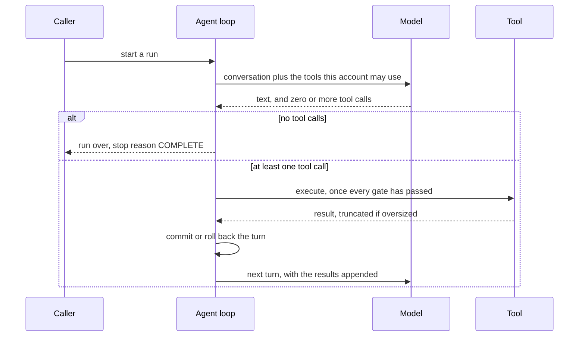
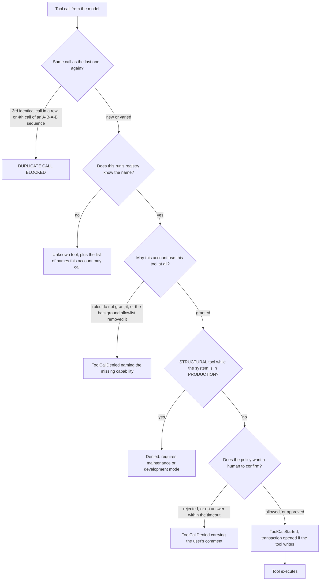
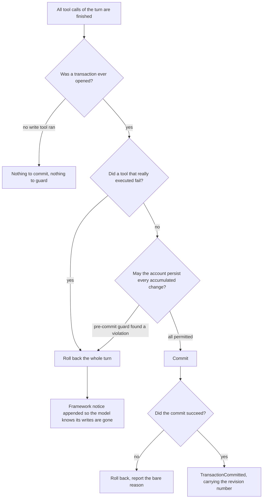
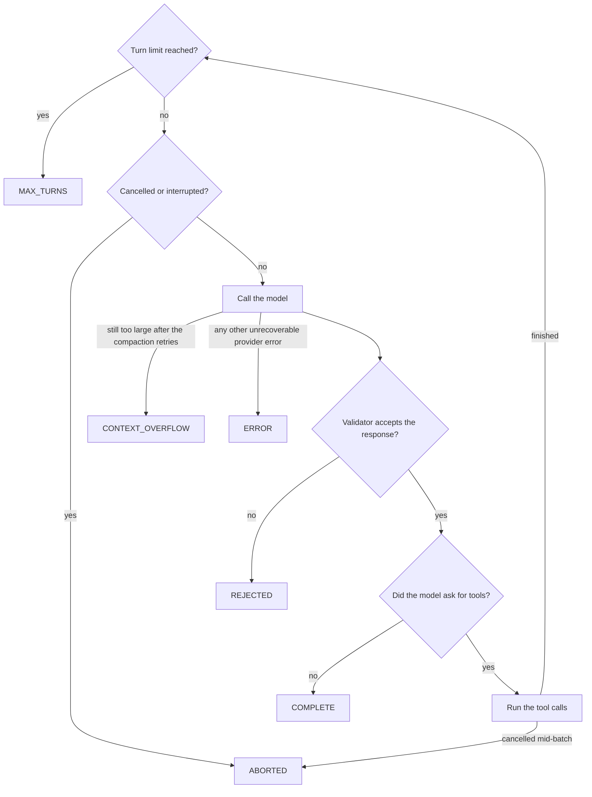

# The agent loop

## In one paragraph

An AI agent in this system is a language model that has been given a task, a set of actions it
may perform, and someone to act on behalf of. The agent loop is the part that turns that into
work: it asks the model what to do next, carries out the actions the model asks for, tells the
model what happened, and asks again - until the model stops asking and answers, or the loop stops
it. Everything that makes this safe to point at real business data lives here: a hard cap on how
many rounds a request may take, a check that the person behind the request may really perform each
action, a prompt to a human for anything consequential, and a rule that the data changes of one
round either all survive or none do. When a run ends, it ends with a stated reason.

## Mental model

Five nouns carry everything else on this page. They are worth reading even if you never open the
code, because they are the words the log lines, the chat UI and the configuration all use.

A **run** is one request handled start to finish: one question from a user, or one job handed to
an agent by a scheduler. A run always ends with a **stop reason** - it finished, it hit its
round limit, it was cancelled, it broke, the answer was refused, or the conversation grew too
large. Nothing else can happen.

A **turn** is one round inside a run: exactly one call to the model, plus whatever the model asked
for as a result of that call. Turns are numbered from 1. Every log line and every UI event carries
its turn number, so "it went wrong in turn 4" is a statement you can act on.

A **tool call** is one named action with arguments, produced by the model - "read this object",
"change that field", "run this script". Tools, not the model, touch the application. A turn can
contain none (then the run is over), one, or many.

The **run context** is the answer to "on whose behalf, with what rights, who confirms, how do we
stop". It travels with the run and is what every tool call is measured against: the identity and
permissions of the acting account, the channel used to ask a human for confirmation, the
transaction the turn's writes go into, and the cancellation signal. In code this is
`ToolContext`, wrapping a `SecurityContext`, an `ApprovalCallback`, a `TransactionScope` and a
`CancellationToken`.

The **turn transaction** is the container for everything a turn writes to the database. It opens
lazily, the first time a turn actually runs a tool that writes, and it closes at the end of the
turn - committed as one revision, or rolled back entirely. There is no partial turn.

How they relate: a run is a sequence of turns; a turn holds zero or more tool calls; every tool
call is checked against the run context before it happens; every write in a turn shares that
turn's fate. The model never gets to skip any of this, because it does not do the work - it only
asks, and the loop decides.

## How it works

This section follows one real turn from the caller's `run(...)` call to the point where the loop
either starts the next turn or returns. The engine is `AgentLoop`
(`tl-ai-core/.../agent/AgentLoop.java`); everything cited below is in that file unless another
file is named.

The shape of one turn first, because everything after it is detail hung off this skeleton. Notice
how often control comes back to the loop: the model never acts, it only asks.



When a run looks stuck, the useful question is which arrow it is sitting on: the call to the model,
a tool that has not returned, or an approval nobody has answered.

**Before any turn, the run is pinned down.** `AgentLoop:securedContext` derives the context the
whole run will use: the caller's context, narrowed to the security mode the agent definition
declares for itself (`AgentParams:securityFloor`) and bound to the loop's model. This happens
once, before the first event is emitted, so a run that must be refused produces no half-run at
all. It is also the single point every run passes through - top-level, delegated, or detached -
which is why the floor is applied here and not at each entry point. Then a fresh
`runId` (a UUID) is generated and `AgentEvent.RunStarted` goes out. From here on the caller's
listener is wrapped in `AgentEventListener.serializing(new DiagnosticLoggingListener(listener))`,
so events are never delivered concurrently and every event can also become a log line.

**Top of the turn.** `AgentLoop:runLoop` is a plain `for (int turn = 1; turn <= maxTurns; turn++)`.
Each iteration first checks `Thread.interrupted() || context.cancellationToken().isCancelled()`
and gives up with `StopReason.ABORTED` if either is true. Then `AgentEvent.TurnStarted`, then
`AgentLoop:injectBetweenTurns`, which appends the results of any detached subagents that finished
since the last turn as system messages reading `Subagent <name> (<id>) finished with status
<status>:` followed by the child's final text. This is the one place where information enters the
conversation from outside the model/tool exchange.

**The provider call.** `AgentLoop:callProviderOnce` builds the request. Two things matter here.
First, the tool list is filtered per turn through `new ToolPermissionFilter(context.security())`,
so the model is never shown a tool this account cannot use - the same filter that later gates
execution. Second, the response is streamed: `LLMProvider.stream(request, collector)` pushes
`StreamEvent`s into the private `ResponseCollector`, which forwards text and thinking chunks
straight on as `AgentEvent.TextDelta` / `ThinkingDelta` (this is what makes the chat UI type as the
model types) and accumulates the rest into one `AssistantMessage`.

Around that, `AgentLoop:callProvider` retries `RATE_LIMITED` and `OVERLOADED` up to
`AgentParams:maxRetries` times with exponential backoff from `AgentTuning.BASE_BACKOFF_MS`,
capped at 30 seconds and honouring a `retry-after` header when the provider sent one. The wait is
slept in `AgentTuning.BACKOFF_POLL_MS` slices so a cancellation is noticed within a quarter of a
second. When memory is in play, `callProviderWithReactiveCompaction`
sits one level above: on `CONTEXT_WINDOW_EXCEEDED` it compacts the conversation and tries again,
up to `AgentTuning.MAX_REACTIVE_COMPACT_RETRIES` times.

**What came back.** The assistant message is appended to the conversation, its token usage added
to the run total. `AgentParams:responseValidator` gets a veto - if it returns `false` the run stops
with `StopReason.REJECTED`. Then the loop extracts the `ToolCall` parts. **If there are none, the
model has answered and the run is over with `StopReason.COMPLETE`.** That is the normal exit.

**Dispatch.** With tool calls in hand, `AgentLoop:executeToolCalls` takes over.
`AgentLoop:partitionBatches` splits the calls into consecutive batches: runs of tools that are
safe to execute in parallel, and everything else one at a time. `AgentLoop:isConcurrencySafe`
grants parallelism only to `ToolMode.READ` tools that also report `Tool.isConcurrencySafe()` and
that will not stop for approval. A single-element batch runs on the loop thread
(`AgentLoop:executeSingle`); a larger one is dispatched to the shared `TOOL_WORKERS` pool
(`AgentLoop:executeConcurrent`), with the caller's thread-local bindings and sub-session
re-established on each worker, since worker threads inherit neither.

Every call, parallel or not, then passes the same sequence of gates. This is the part worth
knowing by heart, because almost every "why did my agent not do that?" question is answered by
naming the gate that stopped it.



Read it top to bottom: cheap and local checks first, the human last. The order is deliberate -
**authorization happens before approval** - so a tool this account may not use is refused without
anyone being asked to confirm it. When this goes wrong you see it as the wrong gate being blamed: a
capability named for what was really a misspelled tool name, or an approval prompt for a tool that
was never permitted.

In code the gates live in `AgentLoop:executeWithSecurityCheck`, except the duplicate guard, which
is `AgentLoop:checkDuplicateToolCall` and always runs on the loop thread in call order, even for
calls that will be dispatched to workers. Two details are easy to miss. A name the registry cannot
resolve deliberately skips the permission check, so a typo is answered with
`ToolCatalog:absenceReason`'s `Available: [...]` hint instead of a spurious denial. And
`AgentLoop:ensureTransaction` runs *after* all gates, so a denied write tool never opens a
transaction.

Execution itself is `ToolRegistry.execute(toolCall, execContext)`, with the context extended by
this call's id and a `ProgressReporter` that turns `progress(...)` calls into
`AgentEvent.ToolProgress`. The result comes back as a `ToolResultMessage` and passes
`AgentLoop:truncateIfNeeded`: anything longer than the per-run character budget keeps its first
and last half and reports the gap as `[... N chars truncated ...]`.

**End of the turn.** All results are appended, then the turn's writes are settled.



Note that only the left rollback route reaches the notice: a **failed commit** rolls back and emits
the event, but adds nothing to the conversation, so the model is left believing its writes landed.
That asymmetry is a known gap, not a subtlety - see "Open questions".

The interesting branch is the second decision. `AgentLoop:executeToolCalls` deliberately does not
roll back for *synthetic* failures - a call that was denied, blocked as a duplicate, addressed to
an unknown tool, or rejected while coercing its arguments never reached a tool body, so it cannot
have corrupted anything, and rolling back for it would silently discard the writes of tools that
succeeded in the same turn. Those ids are tracked in `_turnBlockedCallIds`; failures that
`ToolCatalog` itself marks via `ToolState.Failed.synthetic()` are recognised at the same point.
Both real rollback routes - a failed tool and a `PreCommitGuard` violation - go through
`AgentLoop:rollbackTurn`, which also appends the `[Framework notice] ...` user message. That
message exists because the model has already been told, tool result by tool result, that some
writes succeeded; without the correction it would build its next turn on a false picture. When
this goes wrong you see it as an agent confidently reporting a change that is not in the database.

**Then the loop repeats.** With memory configured, `AgentLoop:runWithMemory` additionally checks
`ConversationMemory:shouldCompact` once per turn and compacts proactively if the estimate has
passed the usable budget. And that is the whole turn: the next iteration starts at the cancellation
check.

There are exactly six ways a run can end, and every one of them is reported as a stop reason. This
is the map to keep next to a log file.



Only `COMPLETE` means the model answered; every other ending means the run was stopped from
outside. That is why the stop reason is the first thing to look at when a user says the agent gave
up.

## Seams

Everything the loop touches, and everything that touches it. Each neighbour gets its own page;
here they are only named and bounded.

**Called by** - the loop is never constructed by application code directly:

- `AgentFactory:runAgent` builds `AgentParams`, provider, tool registry and memory from a stored
  agent definition and runs the loop. This is the ordinary path.
- `AgentRunner:run` wraps that with persistent execution recording (an `AgentExecution` row, a
  `CancelSignalObserver`), and is the preferred entry point.
- `DelegationTool` runs a child loop synchronously inside a parent turn;
  `SubagentJob` runs one detached on a pool thread.
- `AIScriptFunctions` (`ai.chat`, `ai.agentChat`, `ai.agentChatAsync`, `ai.callTool`) are the
  TL-Script entry points.
- `tl-chat`'s `ChatProcessor` reaches the loop through `AgentRunner`, and `ChatServlet` is what
  cancels a run by calling `cancel()` on the token.

**Calls out to:**

- `LLMProvider.stream` - the provider system (Anthropic, OpenAI, Mistral, xAI). The loop knows
  only the interface.
- `ToolRegistry.execute` and `ToolRegistry.toolSchemas` - the tool system. Schema generation,
  argument coercion and the registry's own error messages are not the loop's business.
- `SecurityContext.hasToolPermission`, `SecurityContext.checkApproval`, `ToolPermissionFilter`,
  `PreCommitGuard.forRun` - the security layers. The **policy** is documented in
  [`doc/security/agent-security-architecture.md`](../security/agent-security-architecture.md); the
  loop only applies it, in the order shown above.
- `ApprovalCallback.requestApproval` - the human-in-the-loop channel. Blocking; the loop thread
  waits.
- `TransactionScope` - one KB transaction and its object locks per turn. Locking is initiated by
  individual tools via `TransactionScope:acquireLock`, not by the loop.
- `ConversationMemory` - token estimation and compaction.
- `SubagentJobRegistry.takeUndeliveredResults` - between-turn injection of detached results.
- `InteractionRecorder` - a durable record of every pending approval.

**Emits** `AgentEvent` (27 record types) to one `AgentEventListener`. `AgentEvent`'s own JavaDoc is
the authoritative ordering contract; the loop guarantees `RunStarted` first, `RunCompleted` last -
including after an unexpected `RuntimeException`, so an SSE client is never left waiting on a run
that already died - and exactly one terminal event per `toolCallId`. Consumers today:
`DiagnosticLoggingListener` (always installed), `ExecutionRecorder`, `ConversationLogListener`,
`CancelSignalObserver`, and `tl-chat`'s `ChatSSEHandler`.

**Extension points**, in the order you are likely to reach for them: `AgentParams:responseValidator`
(a `Predicate<AssistantMessage>` veto per turn; the default accepts everything),
`SecurityContext` (permission and approval policy), `ApprovalCallback` (where confirmation comes
from), `CompactionStrategy` (how the conversation shrinks), and the `maxResultChars` constructor
argument.

## Configuration

Every value the loop reads at runtime comes from one place: the `<agent-execution>` section of
`LLMService`, either as `default-model` or as a per-agent entry under `<agent-overrides>`. Each
option is optional except the model; leaving one out means "use the default" and is the right
choice until you have a reason.

Resolution order for every tuning value is: **per-agent override, then the model catalogue (where
the catalogue knows the value), then the built-in default** (`AgentFactory:buildConfig`).

```xml
<config service-class="com.top_logic.tl.ai.core.provider.LLMService">
  <instance>
    <agent-execution default-model="claude-sonnet-4-6">
      <agent-overrides>
        <agent name="ResearchAgent"
          model="claude-sonnet-4-6"
          max-turns="40"
          timeout-seconds="300"
        />
      </agent-overrides>
    </agent-execution>
  </instance>
</config>
```

| Option | What it does | Default | When to change it | What breaks if you get it wrong |
|---|---|---|---|---|
| `default-model` | The model every agent uses that has no override of its own. Mandatory in the configuration. | none | Always set once, at deployment. | Missing or blank, and the first run of an agent without an override fails with `No model assigned to agent '<name>' and no default model configured.` |
| `model` | The model for this one agent. | `default-model` | A cheaper model for a simple agent, a stronger one for a hard agent. | If the model cannot call tools and the agent has tools, the run refuses to start: `Agent '<name>' has tools assigned but model '<model>' does not support tool calls.` |
| `max-turns` | Hard cap on rounds in one run. | `25` (`AgentParams.DEFAULT_MAX_TURNS`) | Raise for agents that legitimately need many small steps; lower to bound cost on a chatty agent. | Too low: runs end mid-task with `StopReason.MAX_TURNS` and the user gets a truncated answer. Too high: a looping agent burns tokens for a long time before the cap saves you. |
| `max-tokens` | Maximum output tokens per model call. | the catalogue's `max-output` for the model | Rarely. Lower it only to bound cost per call. | Too low: answers and tool-call arguments are cut off mid-sentence. The loop does not act on the provider's finish reason - it only records it on the message - so a truncated tool call simply arrives with malformed JSON and fails argument parsing. |
| `context-window` | The window size compaction budgets against. | the catalogue's `context-window` | Only when the catalogue entry is wrong or missing for a self-hosted model. | Too high: compaction fires too late and the provider rejects the request with `CONTEXT_WINDOW_EXCEEDED`. Too low: the conversation is summarised away needlessly. |
| `max-retries` | Attempts on a transient provider error (`RATE_LIMITED`, `OVERLOADED`) before giving up. `0` disables retrying. | `3` (`AgentParams.DEFAULT_MAX_RETRIES`) | Raise on a rate-limited shared key; set to `0` in tests that must fail fast. | Too low: ordinary rate limiting surfaces to the user as `StopReason.ERROR`. Too high: a run can sit in backoff for minutes (each wait is capped at 30s, but they add up). |
| `timeout-seconds` | HTTP timeout for one model call. | `120` (`AgentParams.DEFAULT_TIMEOUT_SECONDS`) | Raise for reasoning models on long conversations. | Too low: long turns die as provider errors that look like network faults. |
| `max-tool-result-chars` | Character budget for one tool result before it is truncated head-and-tail. | `20000` (`AgentTuning.MAX_TOOL_RESULT_CHARS`) | Raise when an agent legitimately needs large documents in context; lower to protect the window. | Too high: one big result crowds out the conversation and forces compaction. Too low: results arrive with a hole in the middle and the model works from half the data. A tool may exempt itself per result with a truncation hint. |
| `tool-choice` | `AUTO` lets the model decide, `REQUIRED` means it must call at least one tool, `NONE` means it must not. | provider default | `REQUIRED` for a single-shot extraction agent; `NONE` to make an agent answer from context only. | `REQUIRED` on a conversational agent prevents it from ever finishing: the loop reports `COMPLETE` only on a turn with no tool calls, which such an agent can never produce, so every run ends at `MAX_TURNS`. TODO(uncertain): deduced from `ToolChoice`'s own contract, not pinned by a test. |
| `temperature`, `top-p` | Sampling. Offered only for models whose catalogue entry says they support it. | provider default | Lower for extraction and classification. | High values on a tool-calling agent produce malformed arguments and duplicate calls. |
| `thinking-effort`, `top-k` | Anthropic-specific. | provider default | Raise `thinking-effort` for hard reasoning. | Ignored by non-Anthropic models. |
| `reasoning-effort`, `reasoning-summary` | OpenAI/xAI-specific. | provider default | As above. | Ignored by other providers. |

Two further limits exist but are **not** configurable per application - they are compile-time
constants in `AgentTuning`, which the class's own JavaDoc calls "deliberate knobs":
`MAX_DUPLICATE_TOOL_CALLS` (`2`, the duplicate guard's tolerance),
`MAX_REACTIVE_COMPACT_RETRIES` (`2`), `BASE_BACKOFF_MS` (`1000`) and `BACKOFF_POLL_MS` (`250`).
Changing one is a code change and a rebuild.

The security mode a run enforces is *not* configured here. It comes from the deployment's
`<tool-access>` policy as a ceiling and the agent definition's own declared mode as a floor; see
[`doc/security/tool-access-configuration.md`](../security/tool-access-configuration.md).

## What you can observe

Almost everything the loop does is visible without a debugger, provided you know which string to
grep for. Read this section as a lookup table: symptom on the left, cause and fix on the right.

**Turning the trace on.** The detailed per-run trace is `DEBUG` on the `com.top_logic.tl.ai`
category and off by default, so a production system logs nothing but retries and reactive
compaction. Raise that category to `debug` and every event becomes one greppable line beginning
`run=<runId> turn=<n> <TAG>`, for example:

```
run=8f3c… turn=2 TOOL_OK name=search_model ms=142 resultBytes=2481
run=8f3c… turn=2 PROVIDER_RETRY kind=OVERLOADED attempt=1 waitMs=2000
run=8f3c… turn=3 RUN_END reason=COMPLETE turns=3 ms=8123
```

The tags are `RUN_START`, `RUN_END`, `TURN_START`, `TURN_END`, `TOOL_START`, `TOOL_OK`,
`TOOL_FAIL`, `LOOP_BLOCK`, `TOOL_DENIED`, `TOOL_TRUNCATED`, `APPROVAL_REQUIRED`,
`APPROVAL_RESOLVED`, `TX_BEGIN`, `TX_COMMIT`, `TX_ROLLBACK`, `COMPACT_START`, `COMPACT_DONE`,
`TASKS_UPDATED`, `PROVIDER_ERROR`, `PROVIDER_RETRY` (`DiagnosticLoggingListener:detail`).
`AgentLoop` adds two of its own at the same level: `PROVIDER_REQUEST` (with `tools=`, `messages=`
and the full `toolNames=[...]` the model was offered) and `PROVIDER_MS`. **No payloads are ever
logged** - prompts, arguments and results appear only as byte counts, because they are persisted
elsewhere and may contain customer data.

| If you see | It means | The fix |
|---|---|---|
| `run=… RUN_END reason=MAX_TURNS` and a half-finished answer | The run used all `max-turns` rounds. | Raise `max-turns` for that agent, or split the task. If the turn count looks absurd, look for a `LOOP_BLOCK` line first - the model may have been spinning. |
| `LOOP_BLOCK` lines, and a tool result starting `DUPLICATE CALL BLOCKED: You have already called '<name>' with these exact arguments 2 time(s) in a row.` | The duplicate guard stopped the model calling the identical tool a third time in a row. | Nothing to fix in the loop. The model is stuck; usually its prompt does not tell it what to do with the result it already has, or sampling temperature is too high. |
| A tool result starting `DUPLICATE CALL BLOCKED: You are alternating between '<name>' and a previous call without making progress.` | Same guard, catching an A-B-A-B oscillation that consecutive-repeat counting alone cannot see. | As above. A three-way rotation is *not* caught - see "What this deliberately does NOT do". |
| `TOOL_DENIED` with `reason=Tool '<name>' cannot execute: it modifies shared application state, which requires maintenance or development mode. The system is currently in production mode.` | A `STRUCTURAL` tool was called while `SecurityContext.executionMode()` is `PRODUCTION`. | Expected in a deployed application. Open a maintenance window if the change is intended. |
| `TOOL_DENIED` with `reason=Permission denied: you do not have access to tool '<name>'.` | `hasToolPermission` refused and the policy offered no more specific reason. | An administrator has to grant the tool's group to one of the account's roles. |
| A tool result starting `Unknown tool: '<name>'. Available: [...]` | The model invented or misspelled a name. The list holds exactly the tools this account may call. | Nothing; the model normally corrects itself from the list. Repeated occurrences point at a stale tool name in the agent's prompt. |
| A tool result starting `Tool '<name>' belongs to a skill of yours that is not loaded yet` | Real tool, reachable, but behind a skill the agent has not loaded. | Nothing; the model should load the skill. |
| A tool result starting `Tool '<name>' exists in this application but is not carried by this agent` | The tool exists but is in neither the agent's tool list nor any of its skills. | An administrator has to add it to the agent or to one of its skills. Not a permission problem. |
| `TX_ROLLBACK reason=Tool execution failed`, plus a user message `[Framework notice] Because a tool call in this turn failed, ALL data changes made by tools in this turn were rolled back and NOT persisted — including changes reported as successful. Re-apply any changes that are still needed.` | One tool of the turn really executed and failed, so the turn's whole transaction was rolled back. | Fix the failing tool. The notice is intentional: without it the model would keep believing the earlier writes of that turn landed. |
| `TX_ROLLBACK reason=Pre-commit security check failed`, plus a notice beginning `The data changes of this turn were rolled back and NOT persisted, because your account is not permitted to make all of them:` | The pre-commit guard found a change the account may not make. Only reachable in a mode that enforces model access. | Either grant the account the write, or restrict the agent so it does not attempt it. Each violation is audited by the guard. |
| `TX_ROLLBACK` with a reason and **no** preceding `TX_COMMIT`, and no framework notice in the conversation | The commit itself failed (constraint violation, poisoned transaction). The turn's writes are gone, but unlike the two rows above, the model is not told - it will report success. | Fix the underlying constraint. Treat any user report of "it said it saved but nothing changed" as a candidate for this; see "Open questions". |
| `TX_ROLLBACK` whose reason mentions a nested transaction | A tool opened its own transaction and rolled it back, poisoning the turn's transaction. Tools must not manage transactions. | Fix the tool: the loop owns begin/commit/rollback. |
| `Rolled back: ` as a pill in the chat timeline | The UI rendering of `TransactionRolledBack`. The reason after it is the loop's, already de-duplicated of the `Commit failed: ` prefix. | See the rows above; the pill is not itself a fault. |
| At startup or first use, `No catalog metadata for model '<model>'. Using defaults — define the model in model-overrides for accurate limits.` at `WARN` | The model catalogue has no entry for the configured model, so `max-tokens` and `context-window` fall back to built-in defaults rather than the model's real limits. | Add the model to `<model-catalog>`, or set `max-tokens` and `context-window` explicitly on the agent. Until then, compaction is budgeting against a guess. |
| `PROVIDER_RETRY kind=RATE_LIMITED` or `kind=OVERLOADED` at `INFO` (visible without debug) | A transient provider error; the loop is backing off and will retry. | Nothing, unless it repeats constantly - then the key is under-provisioned or `max-retries` is masking a real problem. |
| `RUN_END reason=CONTEXT_OVERFLOW` | The provider rejected the request as too large even after `MAX_REACTIVE_COMPACT_RETRIES` compactions. | Check that `context-window` matches the real model, and that `max-tool-result-chars` is not letting single results dominate. |
| `COMPACT_START trigger=reactive` at `INFO` | Compaction was forced by a provider rejection rather than chosen ahead of time. Always a sign the proactive check fired too late. | See the known overshoot in "Open questions". |
| `RUN_END reason=REJECTED` | `AgentParams:responseValidator` vetoed the model's response. | Only possible if the application installed a validator; the default accepts everything. |
| `RUN_END reason=ABORTED` | Cancellation or thread interrupt, noticed between turns, inside a concurrent batch, or during a backoff wait. Tool results read `Cancelled.` | Expected when a user presses stop. Across a cluster the request travels as a persisted marker that `CancelSignalObserver` polls. |
| A tool result reading `Concurrent execution failed: <cause>` | A worker thread in a parallel READ batch threw something the loop did not classify. | Look at the named cause; the tool is at fault, not the batching. |
| `Agent run <runId> failed unexpectedly: <message>` at `ERROR`, with a stack trace | An unexpected `RuntimeException` escaped the loop. A terminal `RunCompleted` with `StopReason.ERROR` is still emitted, then the exception is rethrown. | A real bug. The `runId` in the line joins to the persisted execution row. |
| `No MessageComplete event received.` | The provider's stream ended without a completion event. | A provider or transport bug; the run dies as above. |
| A tool result containing `[... 41027 chars truncated ...]` | The result exceeded the character budget and its middle was dropped. | Raise `max-tool-result-chars`, or have the tool paginate. Head and tail are kept deliberately, because both ends usually carry the structure. |
| `This AgentLoop was not created with a ConversationMemory.` | Programming error: `run(ToolContext, AgentEventListener)` was called on a loop built without memory. | Use the constructor that takes a `ConversationMemory`, or the `run(Conversation, ...)` overload. |

## What this deliberately does NOT do

This is the section to read before proposing a change, because most of these are decisions rather
than omissions.

- **It does not judge the model's plan.** There is no critic, no re-planning step, no "are you
  sure". The only per-turn veto is `AgentParams:responseValidator`, and its default accepts
  everything. Quality control belongs in the prompt, the tool set and the approval policy.
- **It does not survive a restart.** A run's state - turn counter, accumulated usage, session
  approvals - lives on the calling thread's stack and in the loop instance. `AgentRunner` persists
  a row and the transcript, so a killed run is *visible* afterwards, but the loop itself has no
  resume path. TODO(uncertain): whether a JVM killed mid-run leaves the `AgentExecution` row at
  status `RUNNING` forever, or whether something reaps it at boot, is not settled by
  `AgentLoop` and would have to be read out of `AgentExecutionStore` and its startup path.
- **It does not make each tool call atomic.** The unit of atomicity is the turn, not the call.
  A turn with five writes and one late failure loses all five. This is why the framework notice
  exists at all. Per-call transactions were not chosen because tools within one turn routinely
  depend on each other's writes.
- **It does not run write tools in parallel.** Only `ToolMode.READ` tools share a concurrent batch.
  The code's own comment gives the reason: a write tool on a worker thread opens its transaction in
  the worker's interaction-scoped `DBContext`, which is auto-rolled-back when that interaction
  unbinds, leaving the shared `TransactionScope` holding a transaction the end-of-turn commit then
  fails on with `Invalid nesting of transactions`.
- **It does not retry a failed tool call.** A tool that throws produces one failed result, which
  goes to the model as information. Deciding what to do about it is the model's job.
- **It does not budget tokens for the whole run.** There is a cap per model call
  (`max-tokens`) and a cap on rounds (`max-turns`), but nothing that stops a run once it has spent
  N tokens. `AgentResult:totalUsage` reports the spend after the fact.
- **It does not catch every kind of loop.** The duplicate guard sees consecutive repeats and
  two-call oscillations. A three-way rotation A-B-C-A-B-C passes, by design - and
  `TestAgentLoop:testThreeWayRotationNotBlocked` pins that, because a genuine
  compare-three-things sequence looks identical from here.
- **It does not check the compaction budget more than once per turn.** A single turn with many
  large tool results can overshoot the window before the check fires; a code comment records a real
  observation of `tokensBefore` at 9041 against a 7000-token window. Not a hard failure - the
  reactive path still catches the provider's rejection - but see "Open questions".
- **It does not check what a tool does with the data it touched.** Per-object read and write
  authorization is the tools' own responsibility via `ToolContext:modelSecurity`, with
  `PreCommitGuard` as the backstop at commit time for tools that checked nothing. The loop only
  decides *whether the call happens*.
- **It does not persist the conversation.** Message history lives in `Conversation` /
  `ConversationMemory` for the duration of the run; persistence is `ConversationLog` and
  `AgentExecutionStore`.
- **It does not manage locks.** `TransactionScope` can, but tools initiate locking on the objects
  they resolve. The loop only releases everything on commit or rollback.

## How to verify it

Nothing on this page needs a running application to check. The behaviour is pinned by unit tests
against a mock provider, and the whole set runs in a few seconds.

```bash
mvn -o -pl tl-ai-core -am test -DskipTests=false \
  -Dsurefire.failIfNoSpecifiedTests=false \
  -Dtest='TestAgentLoop,TestToolCatalog,TestAgentCapabilities,TestPreCommitGuard,TestDetachedSubagentCeiling'
```

Verified against `6be483ce`: 126 tests, 0 failures - `TestAgentLoop` 57, `TestToolCatalog` 26,
`TestAgentCapabilities` 20, `TestPreCommitGuard` 15, `TestDetachedSubagentCeiling` 8.

`TestAgentLoop` is the one that pins this page. Its `suite()` boots the `ThreadContextManager`
module, because tool execution establishes a TopLogic interaction; a plain `TestCase` run is not
enough. The tests worth knowing by name, grouped as the sections above:

| Claim on this page | Test |
|---|---|
| No tool calls means `COMPLETE` in one turn | `testSimpleCompletion` |
| A turn with tool calls loops | `testSingleToolCall`, `testMultipleToolCallsPerTurn` |
| The round cap stops the run | `testMaxTurns` |
| Provider failures map to stop reasons | `testProviderError`, `testContextOverflowAfterCompactionRetries`, `testContextWindowExceededWithoutMemoryIsOverflow` |
| Cancellation is honoured between turns and mid-batch | `testCancellationBeforeTurn`, `testCancellationDuringToolExecution` |
| Event bookends and one terminal event per call | `testEventBookendsAndToolCallMatching`, `testRunCompletedEmittedOnUnexpectedError` |
| Execution-mode gate | `testSystemModeGateDeniesGlobalInProduction`, `testSystemModeGateAllowsGlobalInDevelopment`, `testSystemModeGateAllowsReadInProduction` |
| Approval outcomes | `testUserRejectsToolCall`, `testApprovedForSessionSkipsSubsequentApproval`, `testApprovalTimedOutTreatedAsRejection`, `testApprovalRequestContainsArguments` |
| Denied writes never open a transaction | `testDeniedWriteToolDoesNotOpenTransaction` |
| Transaction lifecycle and rollback | `testTransactionOpenedOnWrite`, `testNoTransactionForReadOnly`, `testTransactionRolledBackOnError`, `testCommitFailureTriggersRollback`, `testRollbackNoticeAddedToConversation` |
| Synthetic failures do not roll back the turn | `testUnknownToolDoesNotRollBackTurn`, `testArgumentCoercionFailureDoesNotRollBackTurn` |
| Pre-commit guard | `testPreCommitGuardRollsBackTheWholeTurn`, `testPreCommitGuardLetsPermittedWritesThrough`, `testReadOnlyTurnNeverAsksTheGuard`, `testLegacyRunIsUnrestrictedAndPaysNothing` |
| Batching rules | `testPartitionBatchesGroupsConsecutiveReads`, `testPartitionBatchesBreaksOnWriteTool`, `testPartitionBatchesBreaksOnUserScopedTool`, `testGlobalToolsForcedSequential` |
| Duplicate guard, including what it lets through | `testConsecutiveDuplicateCallBlocked`, `testAlternatingDuplicateCallsBlocked`, `testDuplicateCounterResetsOnDifferentCall`, `testThreeWayRotationNotBlocked` |
| Truncation | `testResultWithoutHintIsTruncatedInTheMiddle`, `testMaxTruncationHintExemptsResultFromLoopTruncation` |
| Compaction | `testMemoryAutoCompaction`, `testNoMemoryNoCompaction` |
| Response validator | `testResponseValidatorRejectsResponse`, `testResponseValidatorAcceptsResponse`, `testResponseValidatorRejectsResponseWithMemory` |

**One scenario a human can run.** In a running application, open the chat, raise the
`com.top_logic.tl.ai` log category to `debug`, and ask an agent to change a piece of data. You
should see, in order: an approval prompt naming the tool and its arguments; after you confirm, a
`TX_BEGIN` line, the tool's `TOOL_OK` line, and a `TX_COMMIT rev=<n>` line.

Then ask for two changes in one message where the second one fails **inside** the tool - for
example by violating a constraint the model cannot see - and watch for
`TX_ROLLBACK reason=Tool execution failed`, followed by the agent telling you that the first change
was rolled back too. That second half is the framework notice doing its job, and it is the single
most important behaviour on this page. If you instead get a `TOOL_FAIL` and a `TX_COMMIT`, the
second call failed *before* reaching the tool body (bad JSON, an argument that would not coerce),
which is a synthetic failure and deliberately does not roll the turn back. Telling those two apart
by watching whether `TX_COMMIT` or `TX_ROLLBACK` follows is the fastest way to confirm the rule.

## Decisions and why

The choices here are the ones that would be re-made wrongly by anyone reading only the happy path.

**Authorize, then ask.** `AgentLoop:executeWithSecurityCheck` runs `ToolPermissionFilter` before
`SecurityContext.checkApproval`. The alternative - ask first, check after - would let an
`AUTO_APPROVE` session confirm a tool the account may never use, and would show human reviewers
prompts for actions that were never possible. It is also what makes the background allowlist a real
bound on detached subagents: they keep the parent's approval callback deliberately, and it does not
matter, because authorization already refused the tool.

**A blocked call is not a failed call.** Denials, duplicate blocks, unknown names and
argument-coercion failures produce a `ToolState.Failed` result, but the loop tracks their ids in
`_turnBlockedCallIds` and excludes them from the end-of-turn rollback decision. The rejected
alternative - roll back on any failed result - was worse in a specific way: a turn with one
successful write and one hallucinated tool name would silently lose the write.

**All-or-nothing per turn, and tell the model.** Rolling back is not enough on its own, because the
model has already read tool results saying "done". `AgentLoop:rollbackTurn` is therefore the single
route for both rollback causes, and it appends a `[Framework notice]` message in both cases, so
"all-or-nothing" means the same thing and is described in the same shape whether a tool failed or
the security guard intervened. The third rollback cause - a commit that itself fails - does *not*
go through it, which is the inconsistency recorded under "Open questions".

**The security floor is resolved in one place.** `AgentLoop:securedContext` narrows the context
once per run, before any event is emitted. Doing it at each entry point instead would mean four
implementations that can drift; doing it per turn would let an agent widen its own mode mid-run.
The entry points still resolve the same floor when they *build* the context, and have to: an
unrestricted context has no principal, so it cannot be tightened later - only refused.

**An unresolvable tool name skips the permission check.** Counter-intuitive, and load-bearing. Such
a name belongs to no tool group, so the permission check would report a typo as a permission
problem, and the model would lose the `Available: [...]` hint it needs to recover. The list itself
holds only tools this account may call, so following the hint cannot walk into a denial and a typo
cannot disclose capabilities the account lacks.

**Only READ tools run in parallel.** Not a performance compromise but a correctness constraint,
recorded in `AgentLoop:isConcurrencySafe`: a write tool on a worker thread ends up with a
transaction in the worker's interaction-scoped `DBContext`, which is rolled back when that
interaction unbinds, and the shared scope is then left holding a transaction the turn's commit
fails on. A batch also breaks before any tool that might need approval, since blocking a worker
thread on a human is not something to design for.

**Timed polling instead of `join()`.** `AgentLoop:collectBatchResults` polls every unfinished
future for 200ms per tick rather than calling `CompletableFuture.join()`, which waits
uninterruptibly and would make a run un-cancellable while a batch is in flight. It polls
round-robin rather than exhausting one future's timeout before moving on, so cancellation latency
does not grow with batch size. Relatedly, jobs are submitted to the `ExecutorService` directly
rather than through `CompletableFuture.supplyAsync`, because only the resulting `FutureTask`
actually interrupts its worker on `cancel(true)`.

**Truncation keeps both ends.** `AgentLoop:truncateToBudget` keeps the first and last half of the
budget and states the gap, rather than keeping a prefix. A prefix loses exactly the summary,
totals or closing structure that most large results end with. Images and documents are exempt: a
character budget does not describe them, and dropping them would cost the model the very content
the tool was called for.

**A terminal event is guaranteed.** `AgentLoop:run` catches `RuntimeException`, logs it, emits
`RunCompleted` with `StopReason.ERROR`, and rethrows. Without this an SSE client would wait forever
on a run that had already died. `TestAgentLoop:testRunCompletedEmittedOnUnexpectedError` is the
regression test.

**`ToolCallStarted` fires only after every gate.** So a listener may treat it as "this is really
running", and a denied call never produces a start/end pair. This is why `ToolCallDenied` is *not*
preceded by `ToolCallStarted`, which the `AgentEvent` ordering contract states explicitly.

**`checkApproval` is called twice, so it must be pure.** Once by `isConcurrencySafe` to predict
whether a call may join a parallel batch, once as the execution gate. The interface documents the
contract - side-effect-free and stable within a turn - rather than caching in the loop, because a
cache would have to be invalidated on exactly the events an implementation is free to define.

**A loop guard rather than trust.** Blocking a third identical call is a framework decision, not
a prompt instruction, because prompt instructions are advisory and a spinning agent costs money
per revolution. The tolerance is deliberately generous enough (`MAX_DUPLICATE_TOOL_CALLS = 2`) for
legitimate retries and genuine two-way comparisons, and both counters reset the moment a call
breaks the pattern.

**Rollback reasons are not prefixed twice.** `AgentLoop:rollbackReason` strips
`TransactionScope.COMMIT_FAILED_PREFIX` before reporting, because the chat adds "Rolled back: "
itself. The comment names the observed symptom: `Rolled back: Commit failed: Commit failed: ...`.

## Open questions

- **The proactive compaction check is once per turn.** A code comment in `AgentLoop:runWithMemory`
  records the overshoot with real numbers (`tokensBefore` of 9041 and 10868 against a 7000-token
  window) and proposes the fix: check after each tool result inside the batch loop, bounding the
  overshoot to one result instead of one full turn. No ticket yet.
- **`runLoop` and `runWithMemory` are near-duplicates.** They differ in three lines - a token
  baseline update, the reactive-compaction wrapper, and the proactive compaction check. Every
  change to turn handling has to be made twice, and a divergence would be silent. Whether to
  collapse them (memory as a nullable collaborator, or a no-op memory) is unresolved. No ticket
  yet.
- **The duplicate guard's blind spot has no owner.** Three-way rotations are knowingly not caught,
  and the test asserting that is pinning a trade-off rather than a requirement. If spinning agents
  turn out to rotate rather than repeat, this needs a real cycle detector over the turn's call
  history. No ticket yet.
- **A failed commit does not correct the model's picture.** `AgentLoop:commitTransaction` catches
  `TransactionException`, rolls back and emits `TransactionRolledBack`, but does *not* go through
  `AgentLoop:rollbackTurn`, so no `[Framework notice]` is appended - the model finishes the run
  believing writes landed that did not.
  `TestAgentLoop:testCommitFailureTriggersRollback` pins the current behaviour, including that the
  run still ends `COMPLETE`. Whether the notice should be added here too (the argument for it is
  exactly the argument that produced it in the first place) or whether the event and the chat pill
  are considered sufficient is unresolved. No ticket yet.
- **Whether a killed JVM leaves executions stuck at `RUNNING`.** See the TODO(uncertain) above.
- **Whether the per-run session-approval set should outlive the loop instance.**
  `AgentLoop._sessionApprovedTools` is seeded from `ToolContext:sessionApprovedTools` on entry and
  grows during the run, but the loop never writes back, so a tool approved "for the session" during
  run N is re-asked in run N+1 unless the caller propagated it. `tl-chat` does propagate; the
  TL-Script entry points auto-approve and so never notice. Whether any caller is silently affected
  is not settled by this file.

## References

Code, all under `tl-ai-core/src/main/java/com/top_logic/tl/ai/core/`:

- `agent/AgentLoop.java` - `run`, `runLoop`, `runWithMemory`, `securedContext`,
  `callProvider`, `callProviderOnce`, `callProviderWithReactiveCompaction`, `executeToolCalls`,
  `partitionBatches`, `isConcurrencySafe`, `executeSingle`, `executeConcurrent`,
  `collectBatchResults`, `executeWithSecurityCheck`, `checkDuplicateToolCall`, `ensureTransaction`,
  `commitTransaction`, `preCommitGuardPasses`, `rollbackTurn`, `rollbackTransaction`,
  `rollbackReason`, `truncateIfNeeded`, `truncateToBudget`, `reportResult`, `injectBetweenTurns`,
  `ResponseCollector`
- `agent/AgentParams.java`, `agent/AgentResult.java`, `agent/StopReason.java`,
  `agent/AgentTuning.java`
- `agent/ToolContext.java` - `forCurrentUser`, `restrictedTo`, `withModel`, `withToolCallId`,
  `forDelegation`, `forDetachedSubagent`
- `agent/SecurityContext.java` - `hasToolPermission`, `checkApproval`, `restrictedTo`,
  `executionMode`; `agent/ToolPermissionFilter.java` - `test`, `denialReason`;
  `agent/PermissionDecision.java`; `agent/ExecutionMode.java`
- `agent/TransactionScope.java` - `begin`, `commit`, `rollback`, `changes`, `acquireLock`,
  `describeCommitFailure`
- `agent/event/AgentEvent.java` (the ordering contract),
  `agent/event/AgentEventListener.java`, `agent/event/DiagnosticLoggingListener.java`
- `agent/AgentFactory.java` - `runAgent`, `buildConfig`, `buildSubagentLoop`
- `execution/AgentRunner.java`, `execution/CancelSignalObserver.java`,
  `execution/InteractionRecorder.java`
- `security/PreCommitGuard.java` - `forRun`, `check`, `describe`
- `tools/ToolRegistry.java`, `tools/ToolCatalog.java` - `execute`, `executeTool`,
  `unknownToolMessage`, `absenceReason`
- `memory/ConversationMemory.java` - `shouldCompact`, `usableTokens`, `compact`
- `provider/LLMService.java` - `AgentOverride`, `AgentExecutionConfig`, `resolveModelAssignment`;
  `provider/AgentModelAssignment.java`; `provider/ProviderException.java` - `Kind`
- `tl-ai-tool-api/.../ToolMode.java`, `tl-ai-tool-api/.../Tool.java` - `isConcurrencySafe`

Tests: `tl-ai-core/src/test/java/com/top_logic/tl/ai/core/agent/TestAgentLoop.java`,
`.../agent/TestAgentCapabilities.java`, `.../agent/TestDetachedSubagentCeiling.java`,
`.../security/TestPreCommitGuard.java`, `.../tools/TestToolCatalog.java`

Related pages:

- [Security architecture](../security/agent-security-architecture.md) - the policy the loop applies
- [Tool access configuration](../security/tool-access-configuration.md) - the administrator's guide
  to tool authorization
- [Security test bed](../security/testbed.md) - one persona per behaviour, runnable
- [Architecture overview](../architecture.md) - German stakeholder overview of the whole system
- Not written yet, named where this page stops: the tool system and schema generation, the provider
  system, skills and delegation, session persistence and the conversation log, and tl-chat's
  REST/SSE surface.

Tickets: [#286](http://git.top-logic.com/TopLogic/tl-ai/issues/286) (this page).
