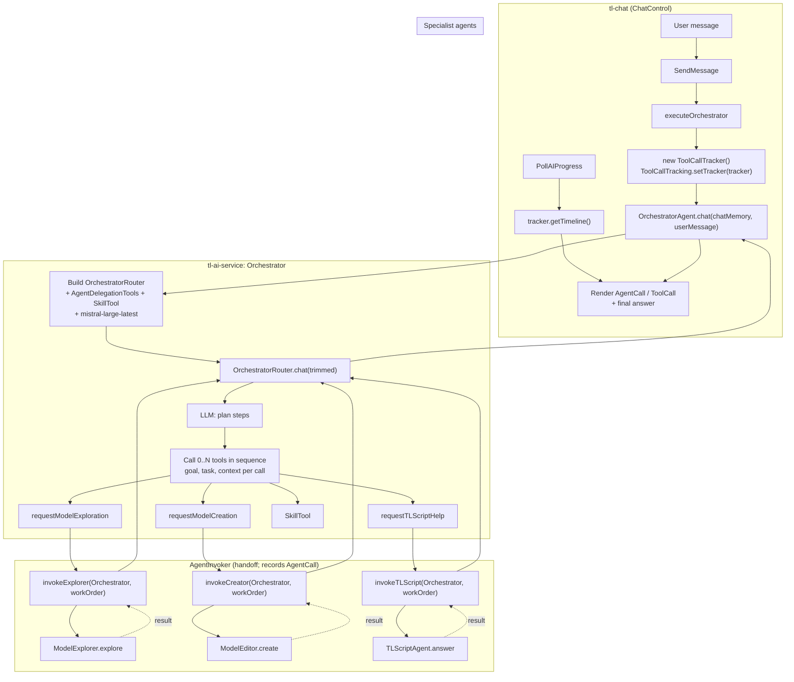

# tl-ai-service

Core TopLogic module providing AI integration via LangChain4j 1.10.0 with thread-safe client pooling, multi-agent orchestration, and TL-Script integration.

## Core Architecture

### Thread-Safe Model Pooling

1. **InteractionContext Binding**: Each model is borrowed from a pool and bound to the current TopLogic `InteractionContext`
2. **Automatic Cleanup**: Models are automatically returned to the pool when the interaction context is destroyed
3. **Reuse Within Context**: Multiple calls within the same context return the same model instance
4. **Per-Model Pools**: Each configured AI model has its own connection pool

Key classes: `AIService` (main singleton), `ChatModelFactory` (factory interface), provider factories in `providers/`.

### Multi-Provider Support

- **OpenAIChatModelFactory**: GPT-3.5, GPT-4, GPT-4o
- **AnthropicChatModelFactory**: Claude 3 (Opus, Sonnet, Haiku)
- **MistralChatModelFactory**: Mistral AI (with auto-discovery)

### Multi-Agent Orchestrator (Chat Entrypoint)

The chat UI sends user messages to **OrchestratorAgent** as the single entrypoint. It reasons about what the user wants, calls **zero, one, or several** specialists in sequence via **AgentInvoker** and a **work-order handoff**, then synthesizes the final answer.



### Handoff Contract (AgentWorkOrder)

- **goal** – Short intent (e.g. "Explore the model and return tool-backed facts")
- **task** – Concrete question or instruction
- **context** – Optional hints (type/part names, module, entity ids)
- **expectedOutputFormat** – Optional (e.g. "JSON with elementIds, fields, annotations")

Callers must fill these fields instead of pasting the full user message.

### Execution Timeline (Observability)

- **ToolCallTracker** holds a unified timeline: `getTimeline()` returns `List<TraceEntry>` in order
- **TraceEntry** is either **ToolCallTraceEntry** or **AgentCallTraceEntry**
- The caller must set `ToolCallTracking.setTracker(tracker)` before calling the Orchestrator

## Configuration

Service config in `src/main/webapp/WEB-INF/conf/tl-ai-openai.conf.config.xml`:

```xml
<config service-class="com.top_logic.ai.service.AIService">
    <instance class="com.top_logic.ai.service.AIService" default-model="gpt-4o">
        <factories>
            <factory class="com.top_logic.ai.service.providers.OpenAIChatModelFactory"
                models="gpt-4o, gpt-4o-mini" api-key="%OPENAI_API_KEY%"
                base-url="https://api.openai.com/v1" max-pool-size="10" />
        </factories>
    </instance>
</config>
```

API keys via environment variables: `tl_openai_apikey`, `tl_anthropic_api_key`, `tl_mistral_api_key`.

## Notes

- Core module (extends `tl-parent-core`), not an application
- Models pooled per model name, not per factory
- API keys must never be committed to version control
- To add a new AI provider, see the `/add-ai-provider` skill
